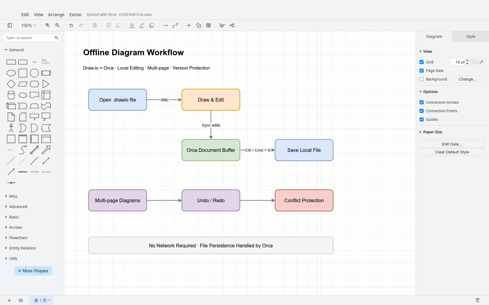
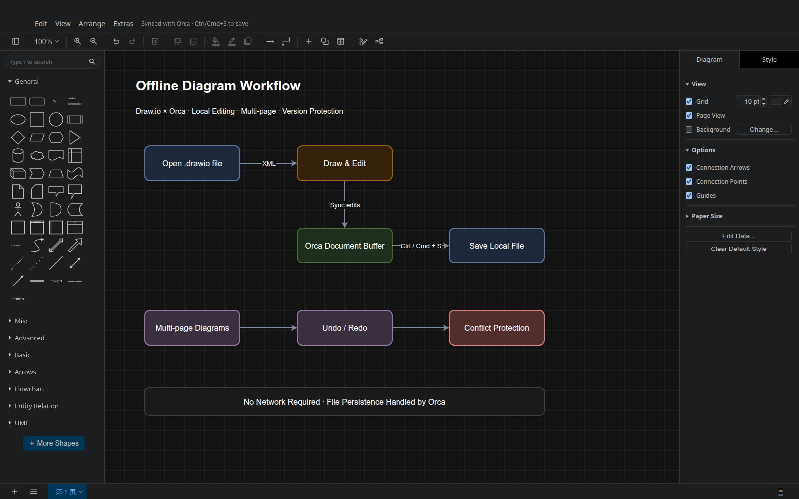

# Draw.io for Orca

Offline editor for `.drawio` and `.drawio.xml` files inside Orca Desktop. Uses the genuine draw.io editor without needing to open online diagrams.net or sending diagrams to remote services. Integrated via Orca's official `sandboxed-ui` / `customEditors` isolated frame interface.






## Features

Add this directory as a local development plugin in Orca's plugin settings (manifest validation required). Create a diagram via the "New Draw.io Diagram" menu or open any existing `.drawio` file. Use the Editor tab for visual editing and the Source tab to inspect/edit XML directly.

- English interface, shape drag & drop, connections, text editing, styling, and layers.
- Standard vector shape libraries: General, UML, ER, BPMN, Flowchart, Basic Shapes, and Arrows.
- Multi-page diagrams, supporting both compressed and uncompressed draw.io XML with custom `mxfile` attributes preserved.
- Undo/redo, zoom, grid, background color, and page setup.
- Automatically follows Orca's light and dark themes; writeback disabled for read-only documents.
- Debounced (~200 ms) synchronization to the Orca document buffer. Dirty status, disk saves, and Ctrl/Cmd+S shortcuts are managed by Orca. Flushes editor state before saving; conflicts are handled cleanly.
- Invalid files display an error and preserve the original text without overwriting with an empty diagram.

## Scope & Limitations

Designed specifically for Orca Desktop's offline XML editor workflow. Runs in an isolated Chromium frame (`frame: isolated`). Cloud storage, online search, AI prompts, remote images/fonts, external plugins, MathJax, and Mermaid/Visio imports are intentionally omitted from this offline build.

Safety limits are enforced to prevent malformed or oversized diagrams from freezing the editor:
- Maximum 16 MB uncompressed document size (8 MB compressed data).
- Maximum 100 pages.
- Maximum 100,000 XML elements.

## Building & Verification

Requires Node.js 22+. The build runs entirely using Node.js built-in modules; distribution outputs reside in `editor/` with zero runtime npm dependencies.

```sh
git clone --filter=blob:none --no-checkout https://github.com/jgraph/drawio.git /tmp/orca-drawio-upstream
git -C /tmp/orca-drawio-upstream checkout 84487b4891cbc0f32d7e30f34cf878c87cb1f414
DRAWIO_DIR=/tmp/orca-drawio-upstream node build/build.mjs
node build/tests/editor.test.mjs
```

The build script validates against the pinned upstream revision, packing the editor core, shapes, minimal BPMN stencils, English locale resources, stylesheets, bootstrapping logic, and host bridge into standalone files.

## License & Notices

Licensed under Apache-2.0. Embeds draw.io 32.6.1 (pinned commit `84487b4891cbc0f32d7e30f34cf878c87cb1f414`), from <https://github.com/jgraph/drawio>. Upstream copyrights and licenses are documented in `THIRD_PARTY_NOTICES.txt` and `LICENSE`.
